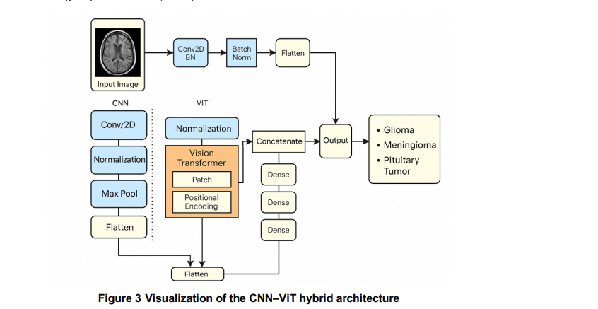

## parallel dual-stream hybrid CNN-ViT model

#### working
The workflow commences with a 224×224 pixel MRI input, concurrently processed by two parallel
streams. The CNN component focuses on extracting local spatial characteristics, whereas the
ViT backbone encompasses global contextual links. The feature vectors generated by each
stream are subsequently concatenated and forwarded via a classification head composed of
dense layers. The final softmax output layer produces the categorization probabilities for the three
tumor categories: glioma, meningioma, and pituitary.

#### 2.7 Vision Transformer Fine-Tuning Strategy
In this study, the Vision Transformer backbone (ViT-Base-Patch16-224) was fully fine-tuned
without freezing any of its layers. The model was initialized using ImageNet-21k pretrained
weights and trained jointly with the CNN branch in an end-to-end manner. Feature extraction from
the ViT branch was performed using the [CLS] token obtained from the last hidden state, which represents the global image-level representation. The same learning rate was applied to both
CNN and ViT components to maintain a unified optimization strategy

#### 2.8 Training and Evaluation Protocol
The evaluation process was created to objectively analyze and compare the efficacy of the two
proposed architectures in classifying three types of brain cancers using MRI scans (Murugesan
et al., 2025). The traditional CNN architecture functioned as the performance baseline for
evaluating the effectiveness of the suggested hybrid CNN–ViT model (Ullah et al., 2023). A range
of callback mechanisms was utilized to enhance the training process and mitigate overfitting. This
incorporated EarlyStopping with a patience of five epochs, which automatically terminated training
if the validation loss did not improve. The ModelCheckpoint callback was set up to preserve solely
the model weights that achieved optimal performance on the validation set. Furthermore,
ReduceLROnPlateau was employed to dynamically modify the learning rate, decreasing it when
progress in learning plateaued. This amalgamation of callbacks is an established technique for
augmenting training stability and promoting model generalization (Murugesan et al., 2025). Both
models underwent training for a maximum of 50 epochs, with performance evaluated across the
training, validation, and testing datasets (Ullah et al., 2023).

## sequential vertical stacking architecture 

#### How the Hybrid Technique Works

• Sequential Feature Extraction (CNN First): Unlike parallel models that run a CNN and ViT side-by-side, this design feeds the input image into a CNN backbone first (such as ResNet or MobileNet) to capture local edges, textures, and spatial hierarchies.
• Feature Map Tokenization: Instead of splitting the raw image into standard patches, the model converts the high-level \(H \times W \times C\) feature maps produced by the CNN directly into a sequence of flattened tokens. This lowers the total token count while keeping important spatial links intact.
• Linear Projection and Positional Encoding: The resulting tokens pass through a linear projection layer to match the required embedding dimension, and positional encodings are added so the transformer tracks their spatial positions.
• Lightweight Transformer Encoder: The token sequence enters a compact transformer encoder with multi-head self-attention to learn global relationships across distant parts of the image.
• Efficiency Optimizations: To keep computing costs low for edge and real-time devices, the authors reduce the number of transformer layers, use sparse attention to avoid quadratic complexity, and apply dimensionality reduction to the token embeddings.
• Classification Head: After the transformer layers refine the representations, a classification (CLS) token or global average pooling combines the local and global features into a single vector, which passes through a fully connected Softmax layer for final prediction.
