##### Experiment 1

Train the classifier

1. label smoothing 0.1
2. class weights used
3. learning rate 3e-4
4. weight decay 1e-4
4. lr schedular CosineAnnealingLR
5. optimizer AdamW

- epochs given - 3
- epochs completed - 3
- model final accuracy - 0.349400

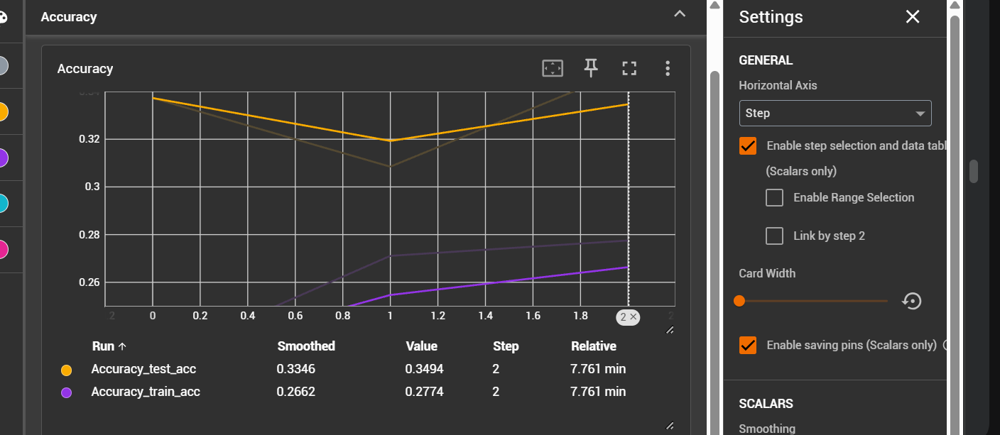
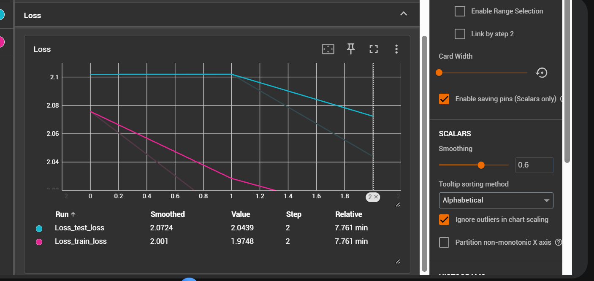

##### Experiment 2

Train the complete model with this configuration

1. label smoothing 0.1
2. class weights used
3. learning rate 5e-5
4. weight decay 1e-2
4. lr schedular CosineAnnealingLR
5. optimizer AdamW

- epochs given - 20
- epochs completed - 15
- model final accuracy -  0.69225

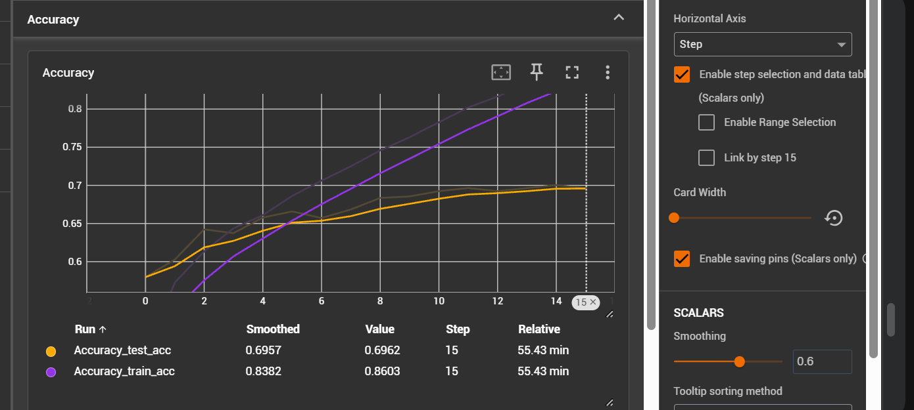
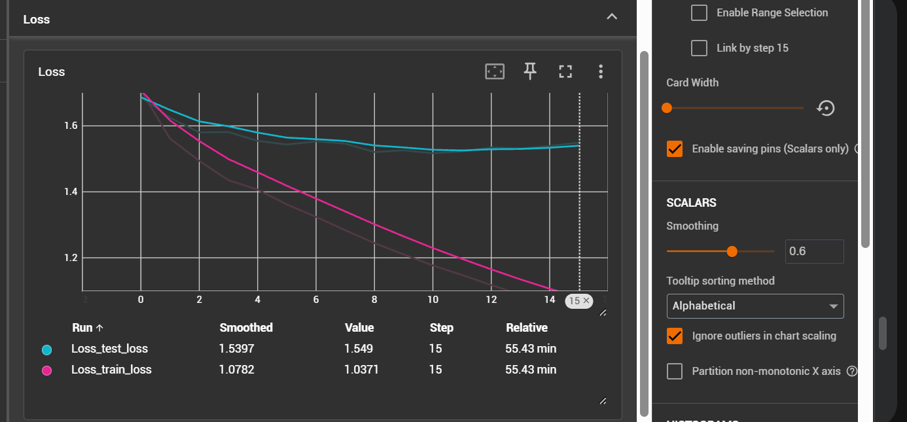

##### Experiment 3

We'll freese the 1st 4 blocks and patch embedding layer

1. label smoothing 0.1
2. class weights used
3. learning rate 5e-5
4. weight decay 1e-2
4. lr schedular CosineAnnealingLR
5. optimizer AdamW

- epochs given - 20
- epochs completed - 7
- model final accuracy -  0.700055

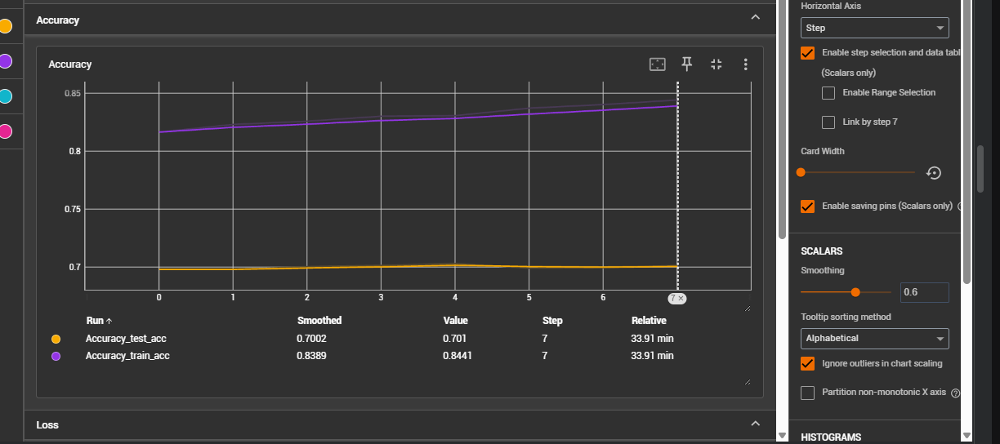
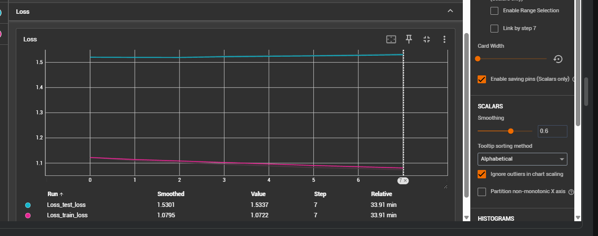

##### Experiment 4

remove class weights

1. label smoothing 0.15
2. class weights not used
3. learning rate 5e-5
4. weight decay 1e-2
4. lr schedular CosineAnnealingLR
5. optimizer AdamW

- epochs given - 20
- epochs completed - 6
- model final accuracy -  0.7092504

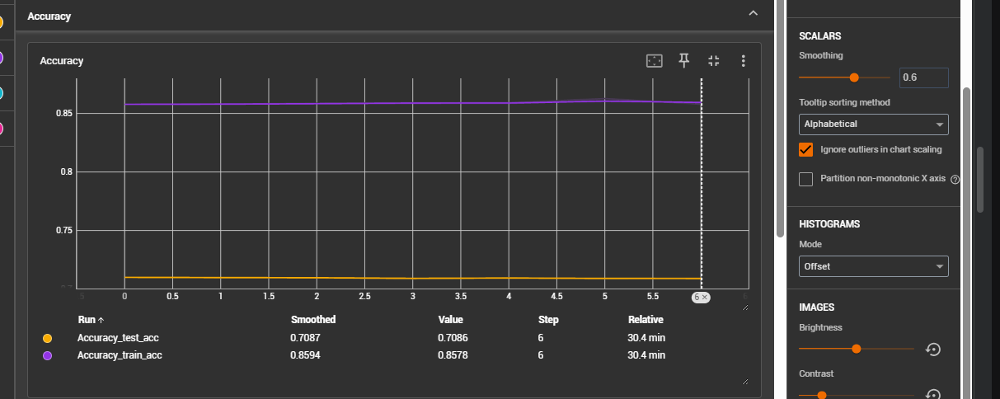
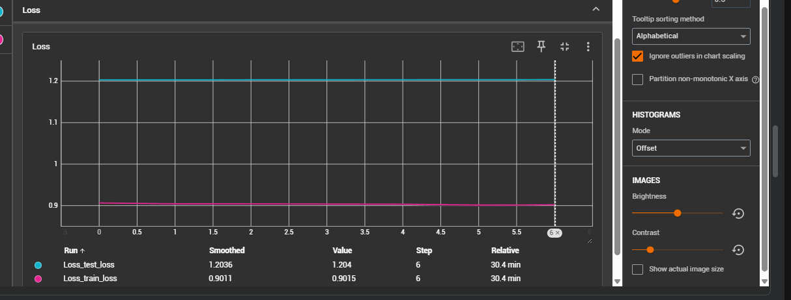

##### Experiment 5

repeat experiment 4 and freeze last 5 blocks

1. label smoothing 0.15
2. class weights not used
3. learning rate 5e-5
4. weight decay 1e-2
4. lr schedular ReduceLROnPlateau
5. optimizer AdamW

- epochs given - 20
- epochs completed - 5
- model final accuracy -  0.6806

graphs not recorded

##### Experiment 6

stronger augumentation, batch size 64

1. label smoothing 0.1
2. class weights not used
3. learning rate 3e-4
4. weight decay 1e-4
4. lr schedular CosineAnnealingLR
5. optimizer AdamW

- epochs given - 20
- epochs completed - 10
- model final accuracy - 0.701448

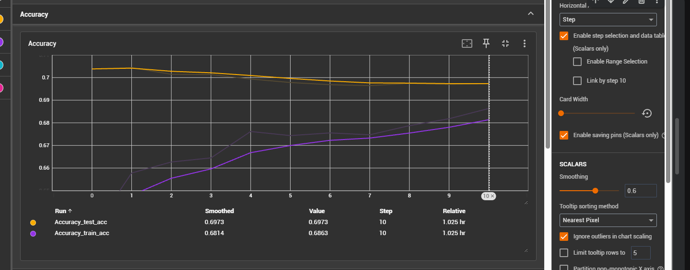
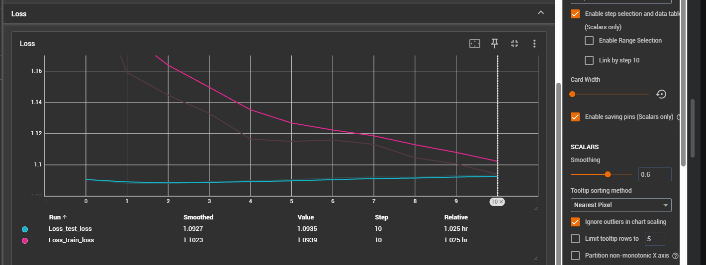

##### Experiment 7

add torch sampler for class balancing  and class weights

1. label smoothing 0.1
2. class weights used
3. learning rate 3e-4
4. weight decay 1e-4
4. lr schedular CosineAnnealingLR
5. optimizer AdamW

- epochs given - 20
- epochs completed - 9
- model final accuracy -0.683198

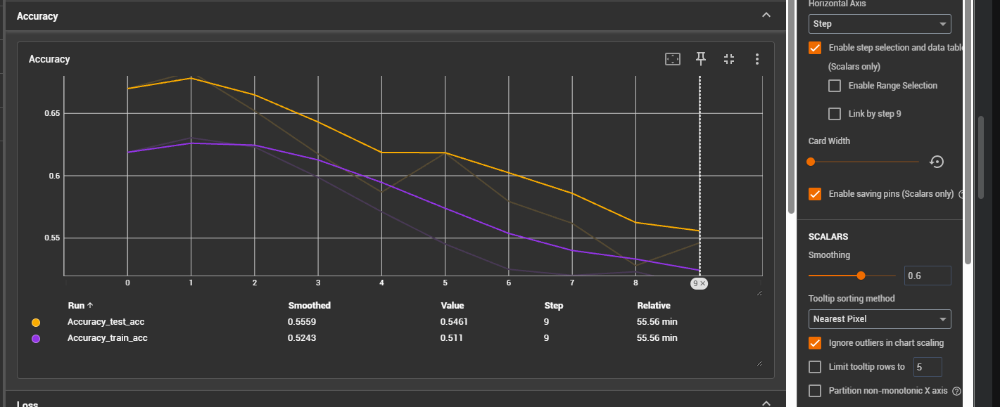
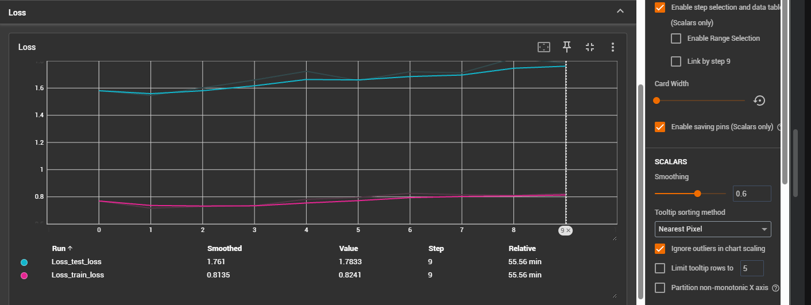

##### Experiment 8

Use original `train_transform` having lighter augmentation ,
add torch sampler for class balancing  and class weights

1. label smoothing 0.1
2. class weights used
3. learning rate 3e-4
4. weight decay 1e-4
4. lr schedular CosineAnnealingLR
5. optimizer AdamW

- epochs given - 20
- epochs completed - 8
- model final accuracy - 0.710086

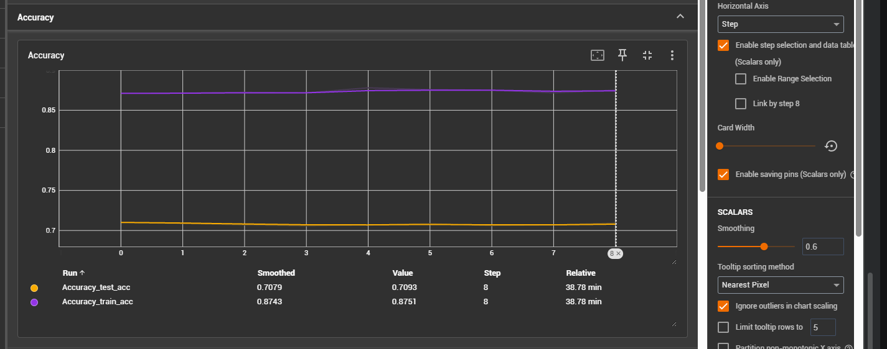
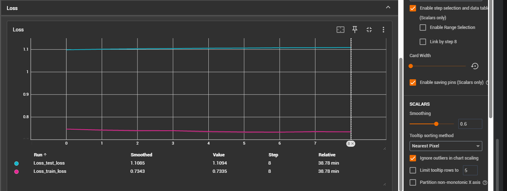