##### Experiment 1

1. label smoothing 0.1
2. class weights used
3. learning rate 0.001
4. weight decay 0.01
5. lr schedular CosineAnnealingWarmRestarts
6. optimizer AdamW

- epochs given - 20
- epochs completed - 13
- model final accuracy - 0.707021

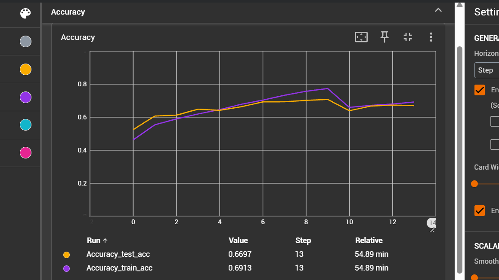
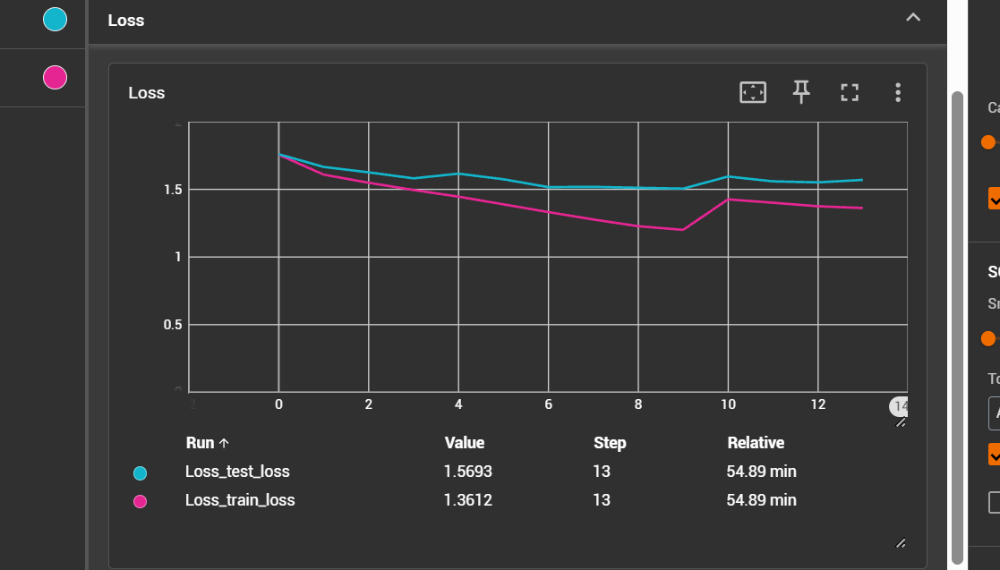

##### Experiment 2 (metric decreased)

Increase the learning rate to 0.01 

1. label smoothing 0.1
2. class weights used
3. learning rate 0.01 -- changed
4. weight decay 0.01
5. lr schedular ReduceLROnPlateau
6. optimizer AdamW

- epochs given - 20
- epochs completed 8
- model final accuracy - 0.68138

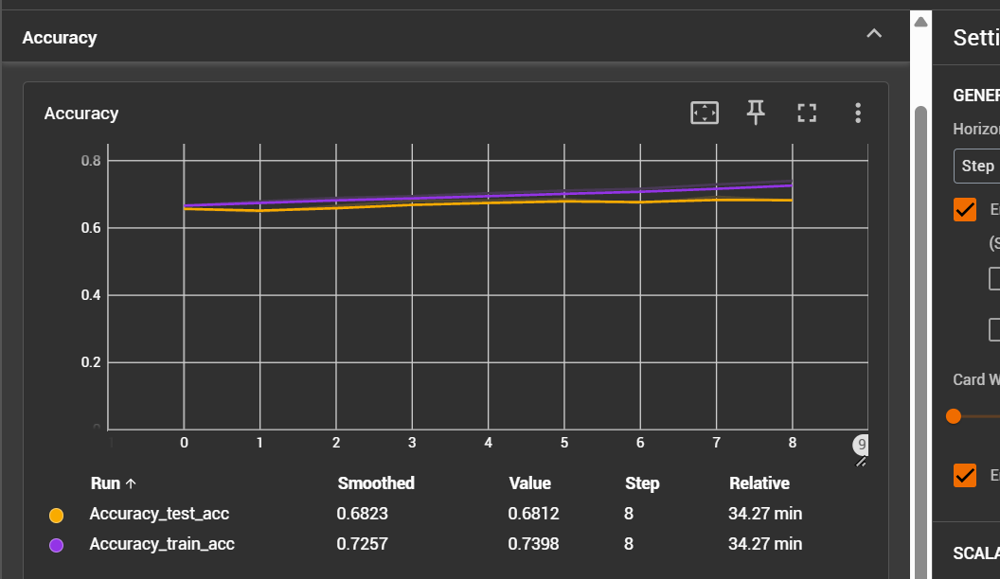
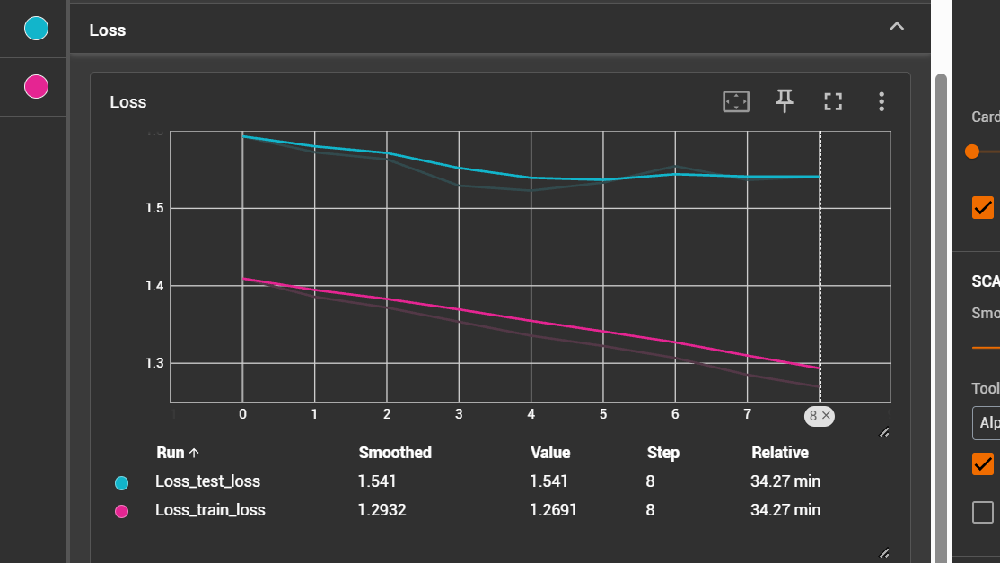

##### experiment 3

changed optimizer to ReduceLROnPlateau

1. label smoothing 0.1
2. class weights used
3. learning rate 0.001
4. weight decay 0.01
5. lr schedular ReduceLROnPlateau -- changed
6. optimizer AdamW

- epochs given - 20
- epochs completed 5
- model final accuracy - 0.67679

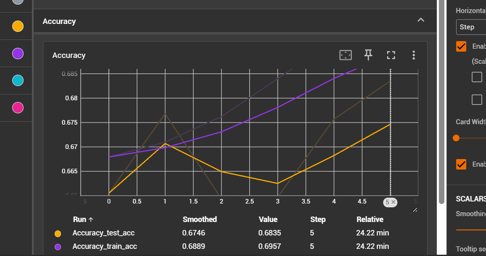
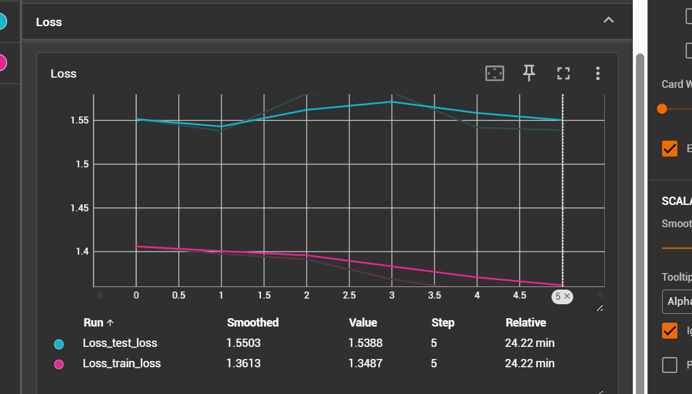

##### Experiment 4

decrease the learning rate to 0.0005, schedular changed to CosineAnnealingWarmRestarts as in experiment 1

1. label smoothing 0.1
2. class weights used
3. learning rate 0.0005 -- changed
4. weight decay 0.01
5. lr schedular CosineAnnealingWarmRestarts
6. optimizer AdamW

- epochs given - 20
- epochs completed 6
- model final accuracy - 0.6985

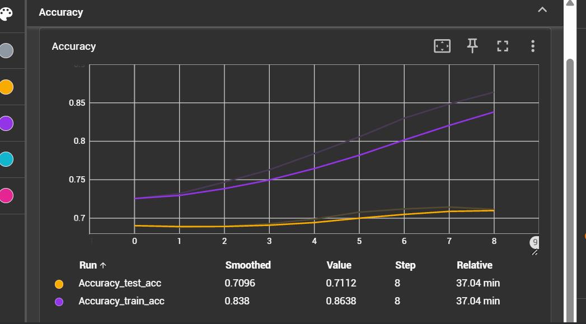
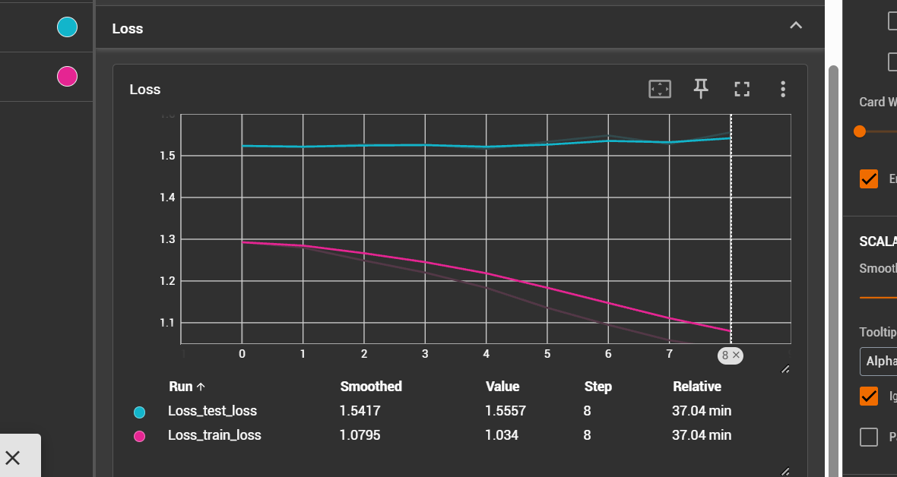

##### Experiment 5

try timm RandAugment. In the default `train_transform` at top added this:

rand_augment_transform(
    config_str='rand-m4-mstd0.25',
    # hparams={'translate_const': 117, 'img_mean': (124, 116, 104)}
    )

see timm implementation here
https://timm.fast.ai/RandAugment#rand_augment_transform

transform pipeline
[transform pipeline](comparing-cnn-models/results/experiment-details-with-graphs/efficientnet_b0/transforms/experiment-5.py)

1. label smoothing 0.1
2. class weights not used
3. learning rate 3e-4
4. weight decay 1e-4
5. lr schedular CosineAnnealingLR
6. optimizer AdamW

- epochs given - 20
- epochs completed - 14
- model final accuracy - 0.6990

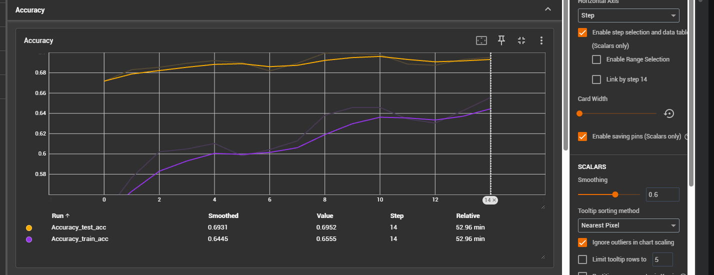
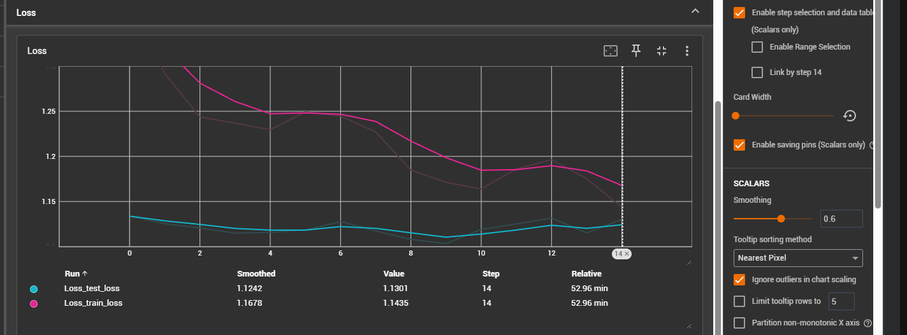

##### Experiment 6

try timm AutoAugment and RandomResizedCropAndInterpolation augumentation pipeline

1. label smoothing 0.1
2. class weights not used
3. learning rate 3e-4
4. weight decay 1e-4
5. lr schedular CosineAnnealingLR
6. optimizer AdamW

transform pipeline
[transform pipeline](comparing-cnn-models/results/experiment-details-with-graphs/efficientnet_b0/transforms/experiment-6.py)

- epochs given - 20
- epochs completed - 5
- model final accuracy - 0.7085

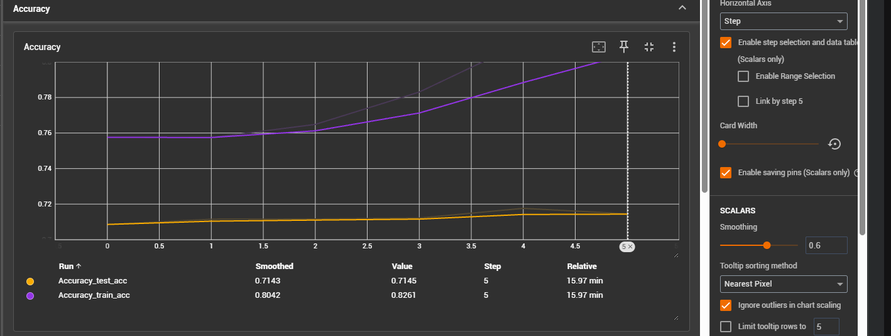
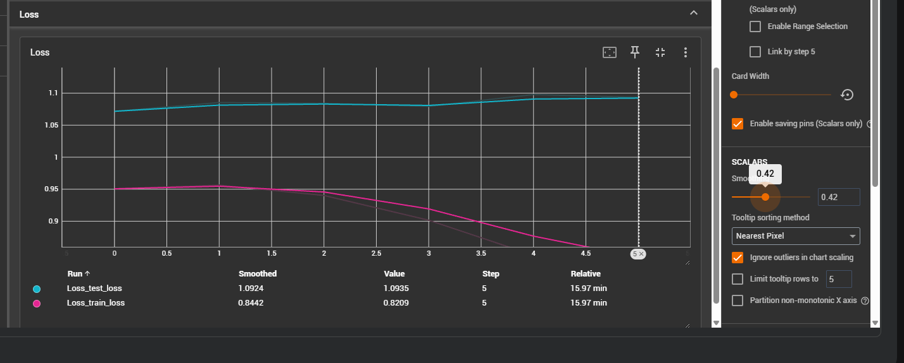

##### Experiment 7

randugument with batch size 64

1. label smoothing 0.1
2. class weights not used
3. learning rate 3e-4
4. weight decay 1e-4
5. lr schedular CosineAnnealingLR
6. optimizer AdamW

transform pipeline
[transform pipeline](comparing-cnn-models/results/experiment-details-with-graphs/efficientnet_b0/transforms/experiment-7.py)

- epochs given - 20
- epochs completed - 5
- model final accuracy - 0.7120

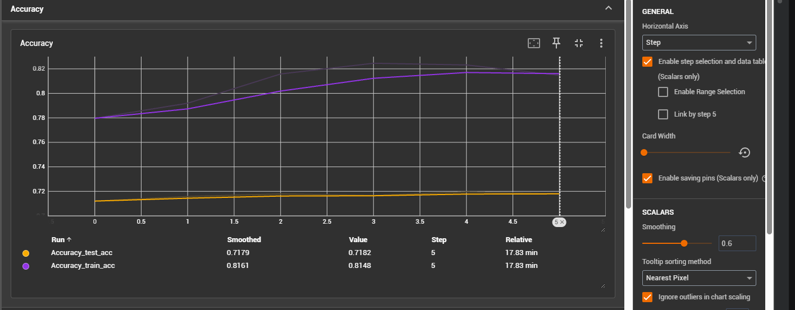
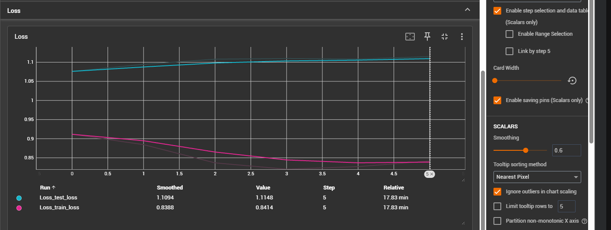

##### Experiment 8

randugument with batch size 64 -- increase the magnitude of random augumentation

1. label smoothing 0.1
2. class weights not used
3. learning rate 3e-4
4. weight decay 1e-4
5. lr schedular CosineAnnealingLR
6. optimizer AdamW

transform pipeline
[transform pipeline](comparing-cnn-models/results/experiment-details-with-graphs/efficientnet_b0/transforms/experiment-8.py)

- epochs given - 20
- epochs completed - 6
- model final accuracy -  0.718584

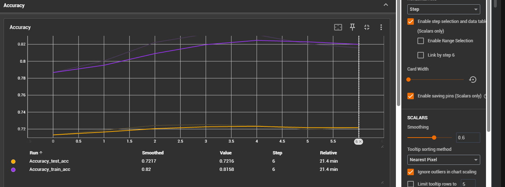
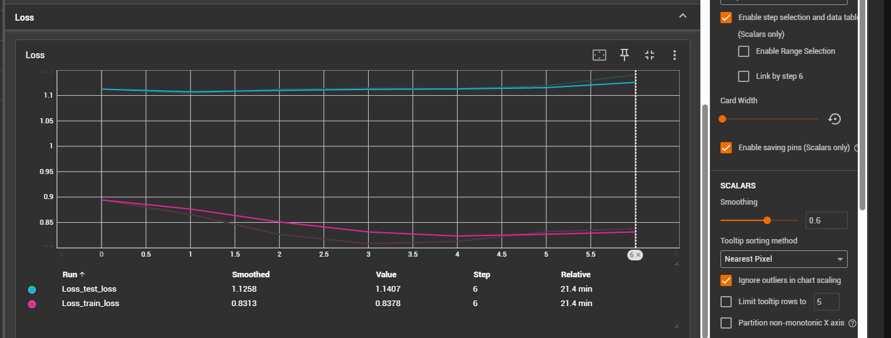

##### Experiment 9

keep the batch size 64 and use another custom transform

1. label smoothing 0.1
2. class weights not used
3. learning rate 3e-4
4. weight decay 1e-4
5. lr schedular CosineAnnealingWarmRestarts
6. optimizer AdamW

transform pipeline
[transform pipeline](comparing-cnn-models/results/experiment-details-with-graphs/efficientnet_b0/transforms/experiment-9.py)

- epochs given - 20
- epochs completed - 8
- model final accuracy -  0.7063248

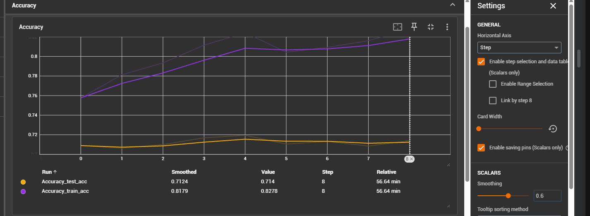
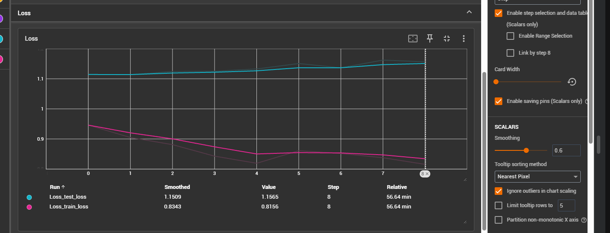

##### Experiment 10

keep the batch size 64 and use another more stronger custom transform

1. label smoothing 0.1
2. class weights not used
3. learning rate 3e-4
4. weight decay 1e-4
5. lr schedular CosineAnnealingWarmRestarts
6. optimizer AdamW

transform pipeline
[transform pipeline](comparing-cnn-models/results/experiment-details-with-graphs/efficientnet_b0/transforms/experiment-10.py)

- epochs given - 20
- epochs completed - 8
- model final accuracy -  0.7167734

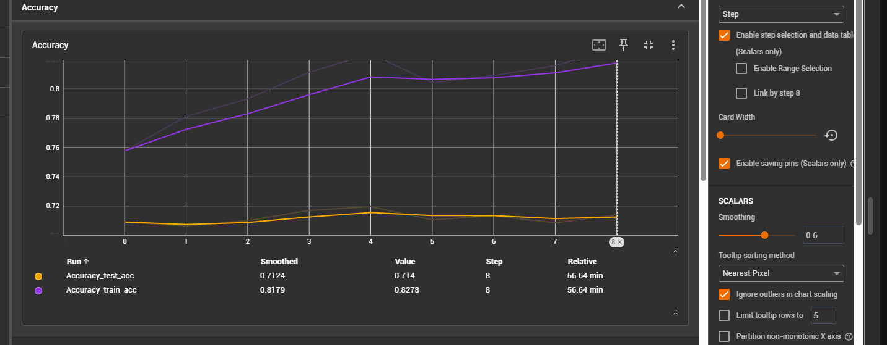
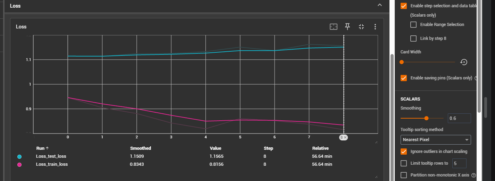

##### Experiment 11

Use light variant of transform `train_transform_aug_6` and use class balancing
keep the batch size 64

1. label smoothing 0.1
2. class weights not used
3. learning rate 3e-4
4. weight decay 1e-4
5. lr schedular CosineAnnealingWarmRestarts
6. optimizer AdamW

well use `torchsampler` for class balancing

- epochs given - 20
- epochs completed - 9
- model final accuracy -  0.713151

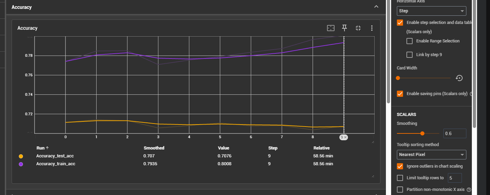
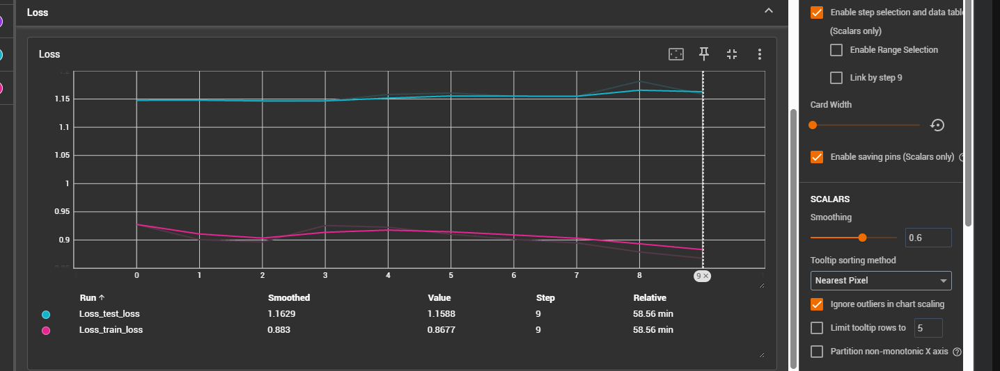

