##### Experiment 1

1. label smoothing 0.1
2. class weights used
3. learning rate 0.001
4. weight decay 0.01
4. lr schedular CosineAnnealingWarmRestarts
5. optimizer AdamW 

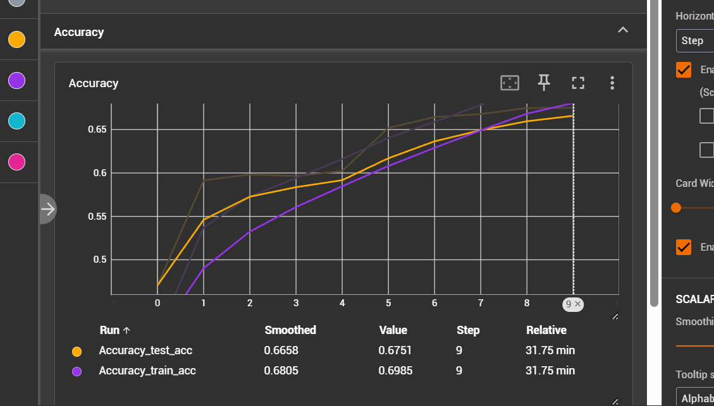
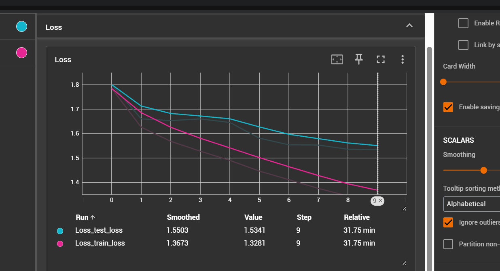

##### Experiment 2 (metric improved)
change schedular from CosineAnnealingWarmRestarts
ReduceLROnPlateau

1. label smoothing 0.1
2. class weights used
3. learning rate 0.001
4. weight decay 0.01
4. lr schedular ReduceLROnPlateau
5. optimizer AdamW

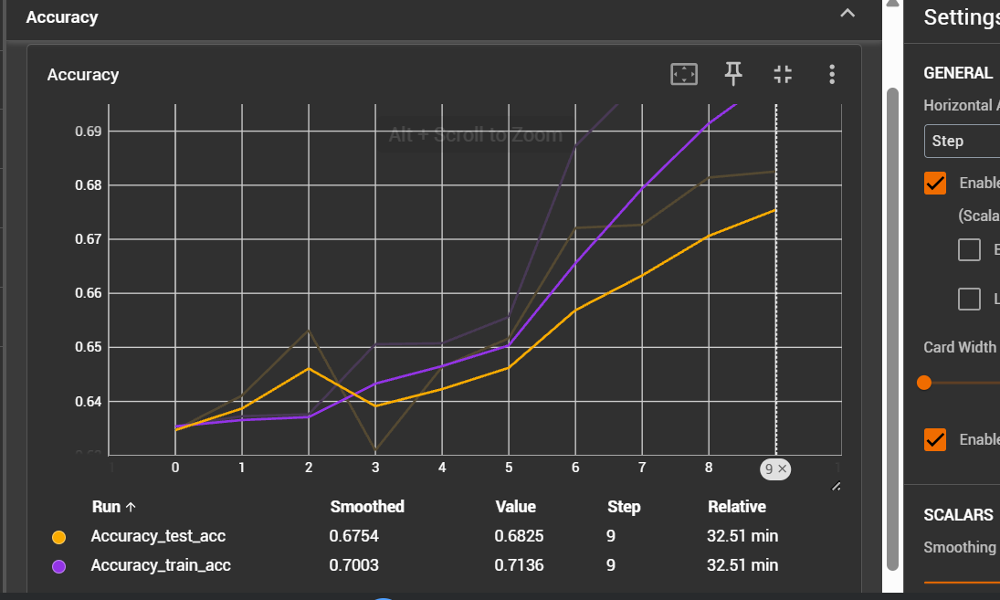
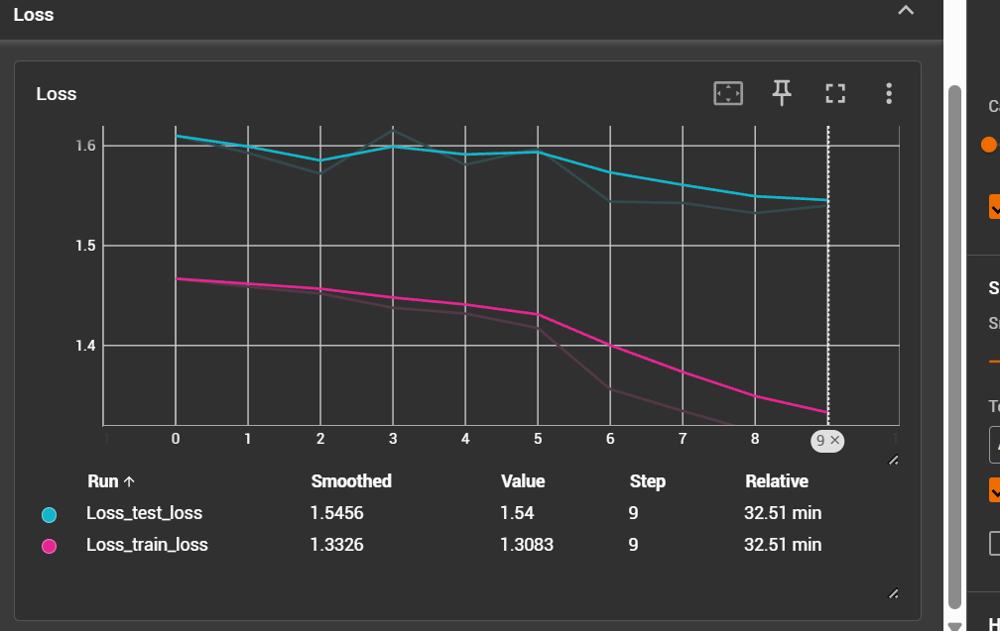

##### Experiment 3 (metric improved)
repeated experiment 2 with more epochs

1. label smoothing 0.1
2. class weights used
3. learning rate 0.001
4. weight decay 0.01
4. lr schedular ReduceLROnPlateau
5. optimizer AdamW

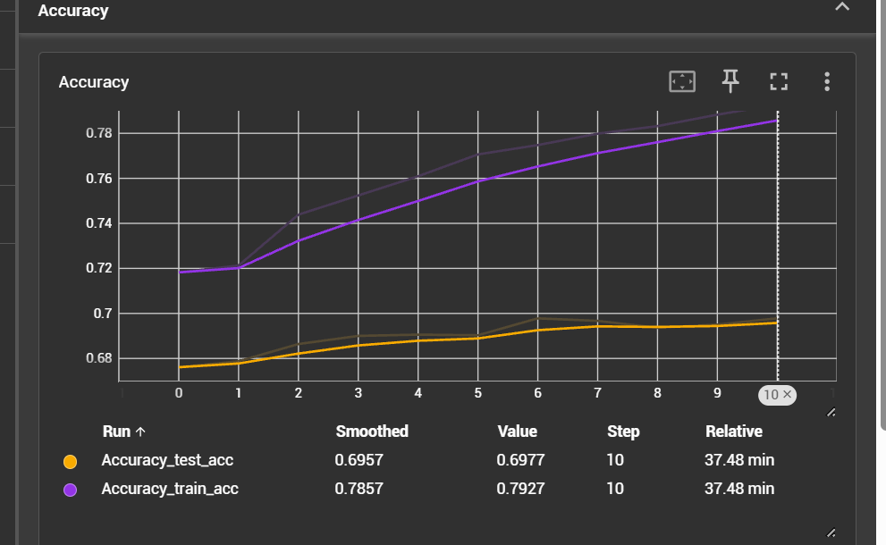
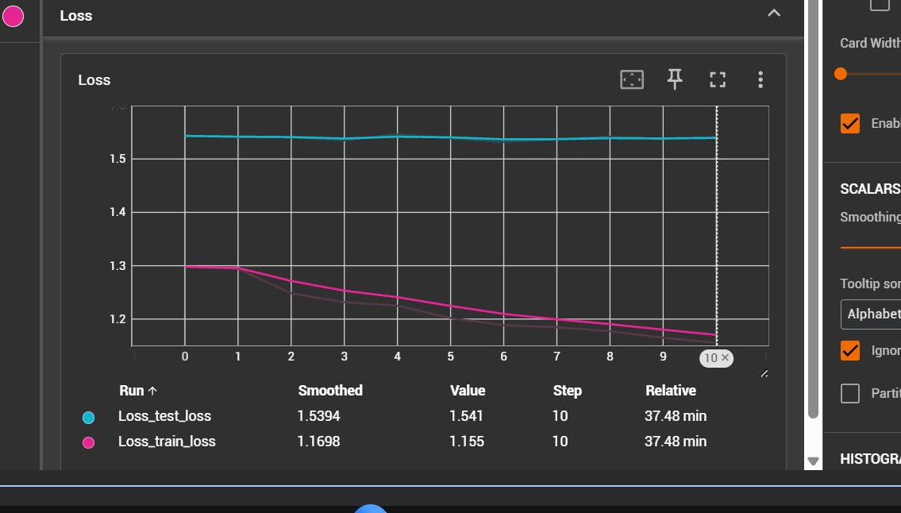

##### Experiment 4

changed label smoothing to 0.001

1. label smoothing 0.01
2. class weights used
3. learning rate 0.001
4. weight decay 0.01
4. lr schedular ReduceLROnPlateau
5. optimizer AdamW

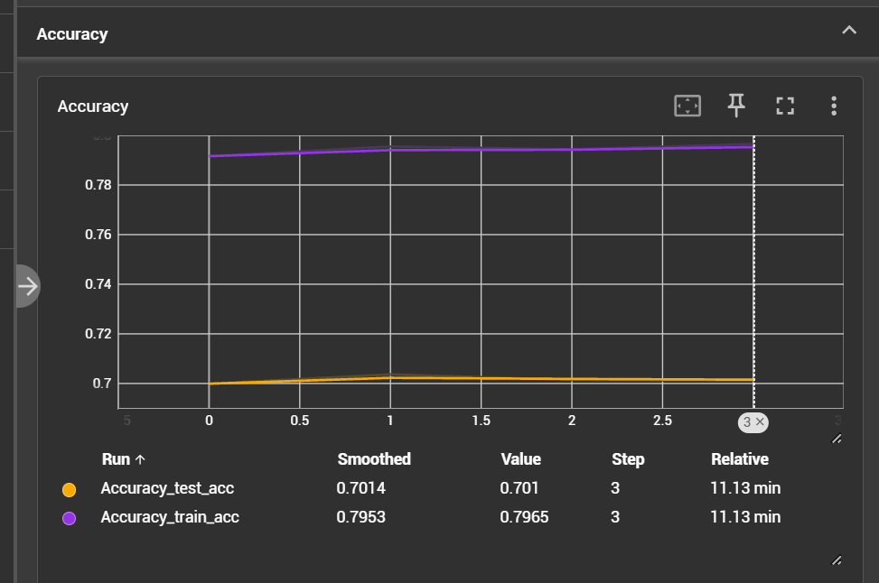
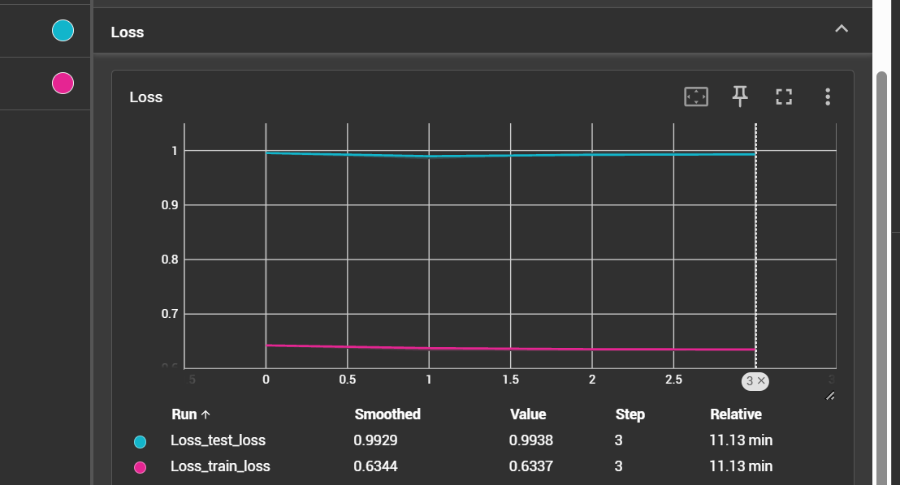

##### Experiment 5

randugument with batch size 64 -- increase augumentation. use `torchsampler` for class balancing

1. label smoothing 0.1
2. class weights not used
3. learning rate 3e-4
4. weight decay 1e-4
4. lr schedular CosineAnnealingWarmRestarts
5. optimizer AdamW

- epochs given 20
- epochs completed - 10
- model final accuracy - 0.697826

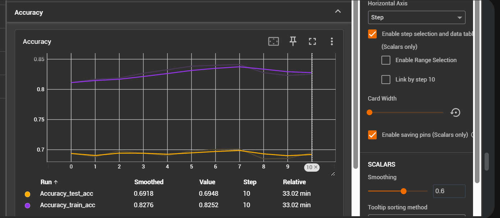
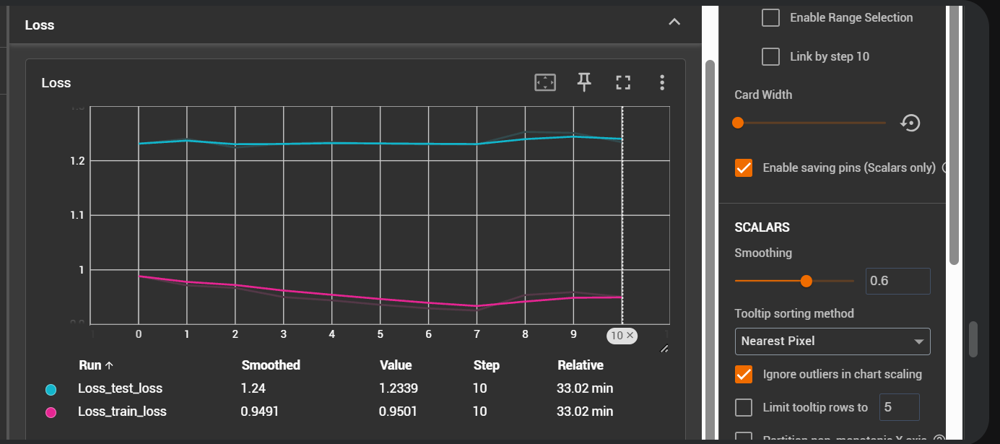

##### Experiment 6

Use other augmentation strategy

1. label smoothing 0.1
2. class weights not used
3. learning rate 3e-4
4. weight decay 1e-4
4. lr schedular CosineAnnealingWarmRestarts
5. optimizer AdamW

- epochs given 20
- epochs completed - 18
- model final accuracy - 0.692114

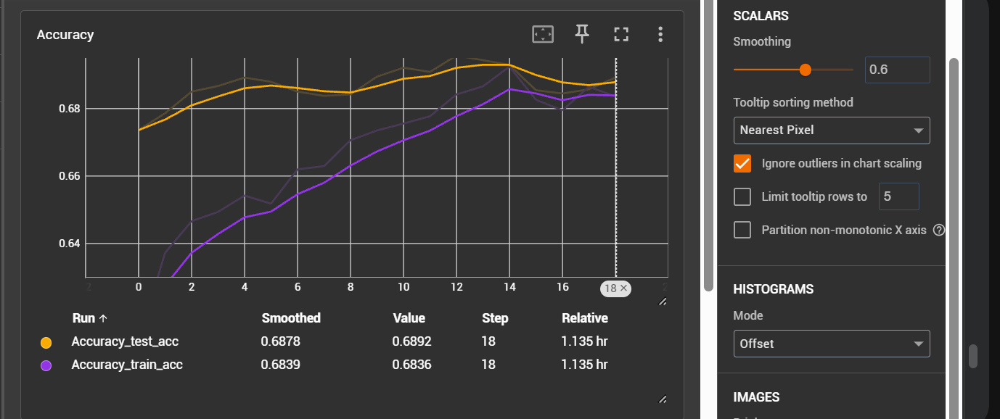
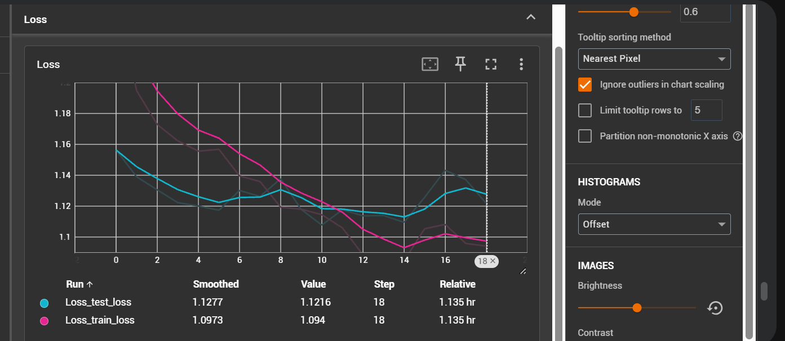

##### Experiment 7

changed label smoothing to 0.001

1. label smoothing 0.01
2. class weights used
3. learning rate 0.001
4. weight decay 0.01
4. lr schedular ReduceLROnPlateau
5. optimizer AdamW

- epochs given 20
- epochs completed - 9
- model final accuracy - 0.69462

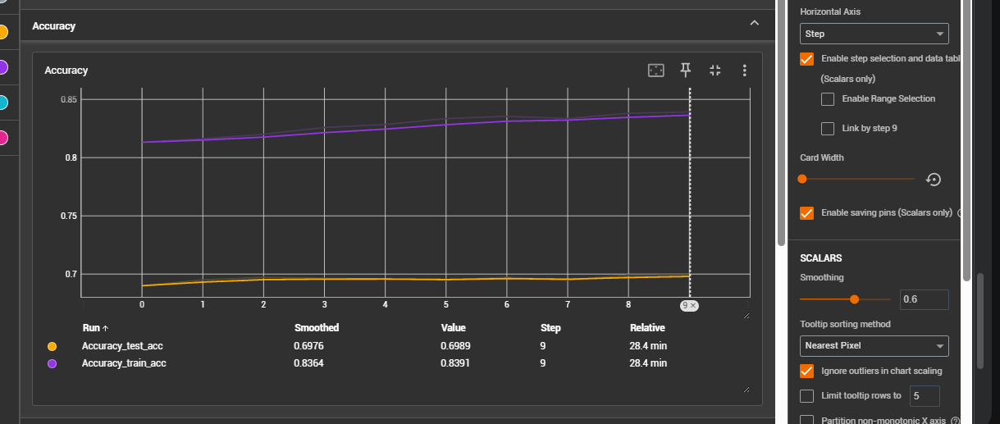

